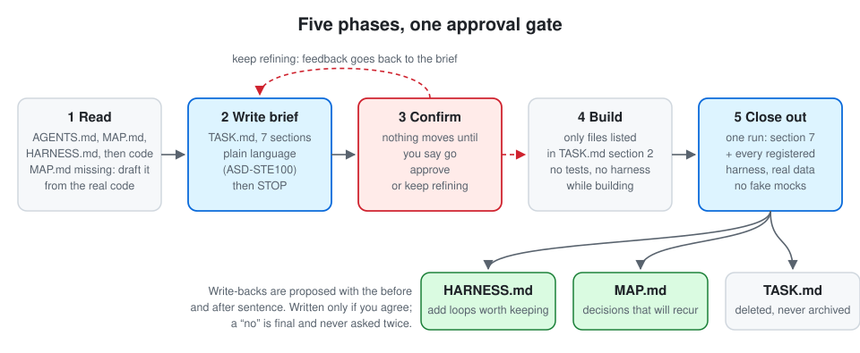
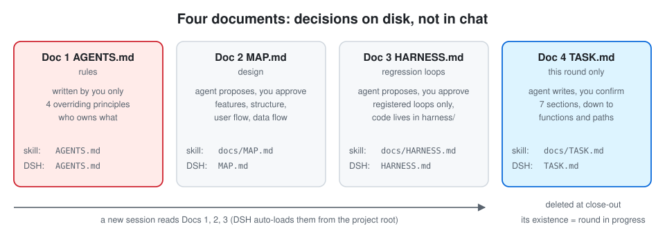
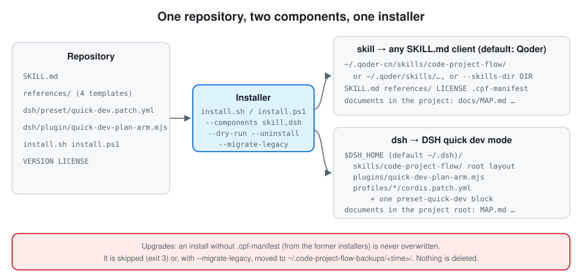
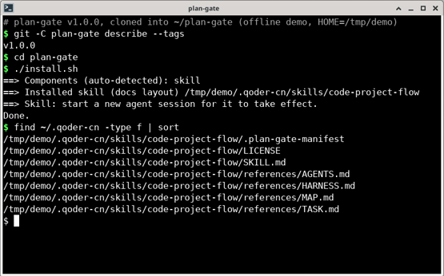
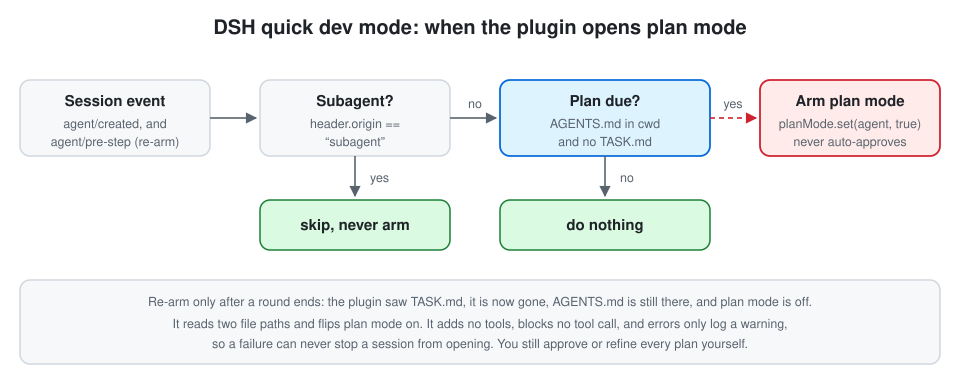

# plan-gate

[English](README.md) | 简体中文

**给 AI 编码助手用的「先交计划、获批后再动手」流程。** 它不管代码*怎么写*，只管助手*什么时候可以开始写*：先写一份简短的当次说明，停下，等你批准，再施工，收工时只跑一次检查。

一个仓库、一套安装脚本，提供两个组件：

| 组件 | 适用于 | 装了什么 |
| --- | --- | --- |
| `skill` | Qoder，以及任何读取 `SKILL.md` 格式的助手客户端 | 施工流程 Skill：`SKILL.md` 加四份文档模板 |
| `dsh` | [DSH（DeepSeek Harness）](https://github.com/deepseek-ai/deepseek-harness) | 与内置「标准模式」并列的「快速开发模式」：同一份 Skill、一个在该交计划时打开计划模式的小插件，以及模式声明 |

> 本项目由 `dsh-quick-dev` 和 `code-project-flow` 两个旧仓库合并而来，见[历史](#历史)和[从 dsh-quick-dev 或 code-project-flow 迁移](#从-dsh-quick-dev-或-code-project-flow-迁移)。
>
> **项目叫 plan-gate，安装出来的 Skill 仍叫 `code-project-flow`。** 见 [Skill 名称](#skill-名称)。

---

## 目录

- [为什么需要它](#为什么需要它)
- [工作方式](#工作方式)
- [安装](#安装)
- [Skill 名称](#skill-名称)
- [从 dsh-quick-dev 或 code-project-flow 迁移](#从-dsh-quick-dev-或-code-project-flow-迁移)
- [DSH 快速开发模式](#dsh-快速开发模式)
- [安全与权限](#安全与权限)
- [自定义](#自定义)
- [目录结构](#目录结构)
- [开发与测试](#开发与测试)
- [历史](#历史)
- [贡献](#贡献) · [许可证](#许可证)

---

## 为什么需要它

让 AI 写代码，常见的坏法有四种：

| 坏法 | 表现 |
| --- | --- |
| 上来就写 | 需求还没对齐，代码已经改了二十个文件 |
| 越改越歪 | 同一处第二次出错，就在旁边再叠一个分支、一层包装、一个开关 |
| 上下文爆炸 | 每个新会话都重读整个仓库，读到的大半是这次用不上的实现细节 |
| 假绿灯 | 测试用 mock 绕过真实路径，本地通过，交付侧一换环境就崩 |

这套流程用**四份文档、五个阶段、四条最高原则**把它们按住，并把「要不要动手」变成一道明确的评审门，而不是对话里一句含糊的「可以了」。

---

## 工作方式

### 五个阶段



1. **读**：先读规则和设计文档。设计文档不存在时，助手从现有代码读出**当前真实形态**来起草，不填理想形态；框架和两条流程留给你看过再继续。
2. **写当次说明**：`TASK.md`，用简化技术语言（ASD-STE100 风格：短句、常用词、一个词一个意思、主动语态）写，固定七节：为什么做；怎么做，细到函数和路径（未列出的文件不得改）；碰到哪里；不要顺手做；和设计文档的冲突；必须你点头的细节；验收边界。**写完即停。**
3. **确认**：你没明确说可以施工，什么都不改。选「继续完善」，你的意见回到当次说明。
4. **施工**：当次说明里写了和设计文档的冲突，就先把那一句改进设计文档。施工期间不跑测试，不跑 harness。
5. **收工**：只运行一次：先按当次说明的验收边界检查这一次，再用真实数据跑全部已登记的 harness，不用假 mock。跑不通就改代码，不得为了绿灯放宽或删除已登记项。然后助手**申请**回写设计文档和 harness 文档，列出改前句和改后句；你同意才写入，不同意就丢掉，不追问第二次。最后删除 `TASK.md`。

### 四份文档



| | 文件 | 谁写 | 管什么 |
| --- | --- | --- | --- |
| 文档1 | `AGENTS.md` | **只有你** | Agent 规则、四条最高原则、文档分工 |
| 文档2 | `MAP.md` | 助手申请，你批准 | 设计：功能选择、项目框架、用户操作流程、数据流程（固定八节） |
| 文档3 | `HARNESS.md` | 助手申请，你批准 | 已登记的回归回路（harness），实现放在 `harness/` |
| 文档4 | `TASK.md` | 助手写、你确认，收工即删 | 只管这一次，细到函数和路径（固定七节） |

文档放在哪里取决于组件：

- **`skill`**：`AGENTS.md` 在项目根，其余三份在 `docs/` 下（`docs/MAP.md`、`docs/HARNESS.md`、`docs/TASK.md`）。
- **`dsh`**：四份都在项目根。DSH 的自动加载是「从工作目录逐级向上找、只认裸文件名」，放在子目录里永远加载不到。安装脚本会按这个布局生成 Skill，源文件只有一份。

这四份文档也是流程的状态：新会话读文档1–3 就知道现在在哪一步，不依赖对话记忆。模板见 [`references/`](references/)。

### 四条最高原则（处女原则）

写在文档1里，和其他指示冲突时以它们为准：

- **不打补丁**：错了就改产生错误的那一处，不在旁边加分支、包装、兼容层、开关或特例。
- **代码自解释**：名字和结构自己说出做什么；注释只写下次会猜错的事（为什么、谁调用、保证什么）。
- **不留残渣**：这次不用的函数、文件、开关、注释掉的旧实现、过期 harness 和当次说明，收工时清掉。
- **部署一致**：本地走通的路径就是交付的路径，不为某台机器写特例，不用假数据。

### 语言

`SKILL.md`、四份模板和 DSH 模式的内置引导都是**中文**。英文 README 用英文解释同样的内容。助手读中文规则、按中文模板写文档，你的代码和注释仍用项目自己的语言。欢迎提交英文模板（见 [CONTRIBUTING.md](CONTRIBUTING.md)）。

---

## 安装



前置：`bash`（macOS、Linux、WSL、Git Bash），或 Windows 上的 PowerShell 5.1 及以上；克隆需要 `git`。`dsh` 组件要求 DSH 至少启动过一次（已经生成 `profiles/`）。

### 推荐：先克隆，再运行

```bash
git clone https://github.com/PakhomLeo/plan-gate.git
cd plan-gate
./install.sh --dry-run      # 先看会改什么
./install.sh                # 安装自动检测到的组件
```

```powershell
git clone https://github.com/PakhomLeo/plan-gate.git
cd plan-gate
powershell -ExecutionPolicy Bypass -File .\install.ps1 -DryRun
powershell -ExecutionPolicy Bypass -File .\install.ps1
```

`-ExecutionPolicy Bypass` 只对这一个进程生效，不改本机策略。

实际效果：下图是在临时 `HOME`（`/tmp/demo`）里对 v1.0.0 不带参数运行 `./install.sh` 的真实输出，后面列出了装好的文件。



### 参数

| `install.sh` | `install.ps1` | 含义 |
| --- | --- | --- |
| `--components skill,dsh` | `-Components skill,dsh` | 装哪些：`skill`、`dsh` 或 `all`。默认自动检测（见下） |
| `--skills-dir DIR` | `-SkillsDir DIR`（别名 `-SkillsRoot`） | `skill` 的目标目录。默认 `~/.qoder-cn/skills` 或 `~/.qoder/skills` |
| `--dsh-home DIR` | `-DshHome DIR` | `dsh` 的 DSH 主目录。默认 `$DSH_HOME`，其次 `~/.dsh` |
| `--uninstall` | `-Uninstall` | 卸载本脚本装过的东西 |
| `--migrate-legacy` | `-MigrateLegacy` | 把旧安装脚本装的内容移到备份目录，然后继续 |
| `--dry-run` | `-DryRun` | 只打印计划的改动，不改任何文件 |

自动检测：存在 Qoder 的 skills 目录或给了 `--skills-dir`，就选 `skill`；存在 `$DSH_HOME/profiles` 或给了 `--dsh-home`，就选 `dsh`。两者都没有时，把 `skill` 装进 `~/.qoder-cn/skills`。如果已经装在 `~/.qoder/skills`，更新会落在那里。

退出码：`0` 完成，`1` 出错，`2` 参数错误，`3` 完成但跳过了某一步（比如需要 `--migrate-legacy` 的旧安装）。

### 其他助手客户端

任何从目录加载 `SKILL.md` 的客户端都可以用 `skill` 组件：

```bash
./install.sh --components skill --skills-dir /path/to/your/client/skills
```

装完新开一个会话，Skill 在会话开始时加载。

### 备选：从 Release 一行命令安装（先下载、再校验、后执行）

每个 Release 都带这些附件，由 [`.github/workflows/release.yml`](.github/workflows/release.yml) 调用 [`scripts/make-release.sh`](scripts/make-release.sh) 生成：

| 附件 | 内容 |
| --- | --- |
| `plan-gate-vX.Y.Z.tar.gz`、`plan-gate-vX.Y.Z.zip` | 该标签的源码树，含两个安装脚本 |
| `install.sh`、`install.ps1` | 同样的安装脚本，单独提供 |
| `SHA256SUMS` | 上面四个文件的 sha256 |

**校验和是 Release 附件，不是提交在仓库里的文件**，只用来校验下载到的 Release 附件。它能发现下载损坏或被篡改，但防不了 GitHub 账号本身被攻破，因为校验和来自同一个地方。下面的命令先下载压缩包，校验通过后才从解压目录运行安装脚本，不会再去拉别的东西。

macOS / Linux（macOS 没装 coreutils 时，把 `sha256sum -c -` 换成 `shasum -a 256 -c -`）：

```bash
V=v1.0.0; B=https://github.com/PakhomLeo/plan-gate/releases/download/$V
mkdir -p plan-gate-dl && cd plan-gate-dl \
  && curl -fsSLO "$B/plan-gate-$V.tar.gz" && curl -fsSLO "$B/SHA256SUMS" \
  && grep " plan-gate-$V.tar.gz\$" SHA256SUMS | sha256sum -c - \
  && tar xzf "plan-gate-$V.tar.gz" && bash "plan-gate-$V/install.sh"
```

Windows（PowerShell）：

```powershell
$V = 'v1.0.0'; $B = "https://github.com/PakhomLeo/plan-gate/releases/download/$V"; $f = "plan-gate-$V.zip"
Invoke-WebRequest "$B/$f" -OutFile $f; Invoke-WebRequest "$B/SHA256SUMS" -OutFile SHA256SUMS
$want = (((Get-Content SHA256SUMS) -match "  $([regex]::Escape($f))$") -split '\s+')[0]
if ((Get-FileHash $f -Algorithm SHA256).Hash -ne $want) { throw 'SHA256 mismatch: do not run it' }
Expand-Archive $f -DestinationPath .
powershell -ExecutionPolicy Bypass -File ".\plan-gate-$V\install.ps1"
```

安装参数加在最后一行末尾，比如 `--components dsh` 或 `-Components dsh`。校验已经下载好的文件：Linux 用 `sha256sum -c --ignore-missing SHA256SUMS`，较新的 macOS 用 `shasum -a 256 -c --ignore-missing SHA256SUMS`，Windows 用 `Get-FileHash 文件 -Algorithm SHA256`，再和 `SHA256SUMS` 里那一行对照。

### 设为默认（Qoder）

安装只让 Skill「可用」。要让所有写代码的任务都走这套流程，在全局 `~/.qoder-cn/AGENTS.md`（或某个项目的 `AGENTS.md`）里加一段，原样照抄：

```markdown
凡写代码、改代码、把功能落到仓库的任务，默认使用 skill code-project-flow。
开工先写 docs/TASK.md 并停下等确认。
```

不加这一段时，说「开工」「收工」「MAP」「当次说明」「harness」等触发词，或直接点名，也会触发。安装脚本从不修改你的 `AGENTS.md`。

### 更新和卸载

更新：拉取仓库后重新运行安装脚本。它只改写 `.plan-gate-manifest` 里列出的文件，并删掉旧版本装过、新版本不再提供的文件。

```bash
./install.sh --uninstall                  # 或：--components dsh --uninstall
```

```powershell
.\install.ps1 -Uninstall
```

卸载会删掉清单里的文件、内容与发布版本一致的插件，以及那一段预设。之后 patch 层逐字节回到安装前。你自己放进 Skill 目录的文件和目录本身会保留。

---

## Skill 名称

仓库和项目叫 **plan-gate**。它安装的 Skill 沿用旧名 **`code-project-flow`**：目录是 `skills/code-project-flow/`，`SKILL.md` 里写的是 `name: code-project-flow`。原因：

- 上面那行 Qoder 默认设置写的是 `默认使用 skill code-project-flow`。使用者已经把它写进了自己的 `AGENTS.md`，安装脚本从不改这个文件。改名会让这一行悄悄失效。
- 已有的安装在 `skills/code-project-flow/` 里。名字不变，升级就是原地替换旧 Skill，助手不会同时看到两份相同的流程。
- 触发词和 DSH 模式的引导都用这个名字指代 Skill。

同样的原因，DSH 预设 id（`preset-quick-dev`）、插件文件名（`quick-dev-plan-arm.mjs`）和模式名称都不变。只改了从未离开安装脚本的名字：清单文件是 `.plan-gate-manifest`，备份放在 `~/.plan-gate-backups/`，管道模式的变量是 `PLAN_GATE_REF` 和 `PLAN_GATE_REPO_URL`。

---

## 从 dsh-quick-dev 或 code-project-flow 迁移

安装脚本能识别两个旧安装脚本写下的东西，只在它们写过的位置找。这些已对照旧脚本源码核实。测试会原样运行旧安装脚本，得到真实的旧安装，再做迁移（见[开发与测试](#开发与测试)）。

### 能识别什么

| 旧安装脚本 | 它写了什么 | 新脚本怎么识别 |
| --- | --- | --- |
| `code-project-flow` 的 `install.sh` / `install.ps1` | 把 `github.com/PakhomLeo/code-project-flow` 用 `git clone --depth 1` 克隆到 `<skills>/code-project-flow`。`<skills>` 是第一个参数（`-SkillsRoot`），否则是 `~/.qoder-cn/skills` 或 `~/.qoder/skills`。更新时运行 `git pull --ff-only`。 | Skill 目录（`SKILL.md` 里有 `name: code-project-flow`）没有 `.plan-gate-manifest`，且 `.git/config` 的 origin 是上述地址。报告为 *code-project-flow git checkout*。 |
| `dsh-quick-dev` 的 `install.sh` / `install.ps1` | `$DSH_HOME/skills/code-project-flow/`（`SKILL.md` 和 `references/`，没有标记文件）；`$DSH_HOME/plugins/quick-dev-plan-arm.mjs`；每个 `profiles/*/cordis.patch.yml` 里一段 `id: preset-quick-dev` 的 `- insert:`。运行中断时可能留下 `cordis.patch.yml.dsh-quick-dev.tmp`。 | `$DSH_HOME/skills/` 下没有清单的 Skill 目录（*dsh-quick-dev copy*）。插件看 sha256：plan-gate 带的是同一个文件。预设看 id。残留文件看文件名。 |
| 手动复制，或其他来源的 git 克隆 | 没有清单的 Skill 目录 | 报告为 *manual copy* 或 *git checkout of unknown origin*。 |

`$DSH_HOME` 默认仍是 `~/.dsh`。对每个旧 Skill 目录，脚本还会列出旧脚本没写过的文件（比如你的笔记）。这些文件不会被删：要么留在原目录，要么随目录一起进备份。

### 会做什么

| 对象 | 不加 `--migrate-legacy` | 加 `--migrate-legacy`（或在提示时回答 y） |
| --- | --- | --- |
| 旧 Skill 目录 | 不动。给出警告，退出码 `3`。对 `dsh` 而言，插件和预设此时也不动。 | 整个目录（含 `.git` 和你的文件）移到 `~/.plan-gate-backups/<时间>/`，再在原位置装一份带清单的新副本。 |
| 内容与发布版本一致的插件 | 原地替换（是同一个文件）。 | 同左。 |
| 你改过的插件 | 保留。给出警告，退出码 `3`。 | 移到备份，再替换。 |
| `preset-quick-dev` 预设段 | 原地替换：每层一段，层里其他内容不变。 | 同左。 |
| `cordis.patch.yml.dsh-quick-dev.tmp` | 只报告。 | 移到备份。 |

任何东西都不会被删除。备份目录不再需要时请自己删。看到本次不处理的位置上也有旧安装时，脚本会打印提示。

### 命令

```bash
git clone https://github.com/PakhomLeo/plan-gate.git && cd plan-gate
./install.sh --dry-run                          # 找到了什么、会改什么
./install.sh --migrate-legacy                   # 按自动检测迁移 skill 和 dsh
./install.sh --components dsh --migrate-legacy  # 只迁移 dsh-quick-dev
./install.sh --components skill --skills-dir /path/to/skills --migrate-legacy  # 旧脚本用过第一个参数时
```

```powershell
git clone https://github.com/PakhomLeo/plan-gate.git; cd plan-gate
powershell -ExecutionPolicy Bypass -File .\install.ps1 -DryRun
powershell -ExecutionPolicy Bypass -File .\install.ps1 -MigrateLegacy
powershell -ExecutionPolicy Bypass -File .\install.ps1 -Components dsh -MigrateLegacy
powershell -ExecutionPolicy Bypass -File .\install.ps1 -Components skill -SkillsDir C:\path\to\skills -MigrateLegacy
```

迁移之后，`./install.sh --uninstall` 会卸掉新安装，每个 patch 层逐字节回到 `dsh-quick-dev` 改动之前的样子。

对已有使用者的变化：

- Skill 现在是**复制**安装，不再是 `git clone`。在 skills 目录里 `git pull` 不再是更新方式，请拉取本仓库后重新运行安装脚本。
- `dsh` 的 Skill 副本改用最新的流程文本（按 ASD-STE100 风格用简化技术语言回复），`dsh-quick-dev` 的模式引导里原本就已经这样要求。
- `./install.sh /path/to/skills` 这种位置参数仍可用，但会提示已弃用，请改用 `--skills-dir`。

---

## DSH 快速开发模式

`dsh` 组件会加一个名为「快速开发模式」的模式，在新会话选择列表里排第二。装完后**重启 DSH，新开一个空白会话**再选；DSH 只允许在没有历史的会话上切换模式。

安装脚本写进 `$DSH_HOME` 的内容：

| 位置 | 是什么 |
| --- | --- |
| `skills/code-project-flow/` | 施工流程 Skill，按项目根布局生成 |
| `plugins/quick-dev-plan-arm.mjs` | 在该交计划时打开计划模式 |
| `profiles/*/cordis.patch.yml` | 每个已有 profile 里一段 id 为 `preset-quick-dev` 的顶层 `- insert:` 条目 |

模式声明（[`dsh/preset/quick-dev.patch.yml`](dsh/preset/quick-dev.patch.yml)）复制自 DSH 标准模式的插件列表，改了四处：persona 后缀要求用简化技术语言回复；自动加载的说明文件扩大到 `AGENTS.md`、`CLAUDE.md`、`MAP.md`、`HARNESS.md`、`TASK.md`，预算 200 KB；计划模式的提示词先讲解这套流程，再逐条保留 DSH 标准模式计划模式的全部规则（例如：对话里的同意不算批准；计划阶段除计划文件外不改文件、不提交、不跑格式化；只能通过 `exit_plan_mode` 提交；评审不可用时留在计划模式）；多一行插件。其余各行在编写预设时照抄标准模式，所以工具目录相同。



需要这个插件（[`dsh/plugin/quick-dev-plan-arm.mjs`](dsh/plugin/quick-dev-plan-arm.mjs)），是因为 DSH 新会话默认不在计划模式，模型也没有进入计划模式的工具。工作目录里有 `AGENTS.md`、没有 `TASK.md` 时，它为根代理打开计划模式；一轮的 `TASK.md` 消失之后再打开一次。它跳过子代理，不加工具，不拦截任何工具调用，出错只记一条警告。

已知边界（设计如此）：

- 只有空白会话能切换模式（DSH 的规则）。
- 设置页把它列在「自定义」下；新会话列表按 `order: 1.5` 排序。
- 模式不继承。DSH 更新标准模式时，这份副本不会跟着变；DSH 发新版后请对照检查 `dsh/preset/quick-dev.patch.yml`。
- 流程纪律是引导，不是围栏。它不按阶段增减工具，因为改工具表会让提示缓存失效。
- 不修改 DSH 源码。

---

## 安全与权限

**安装脚本**（`install.sh`、`install.ps1`）：

- 从不使用 `sudo` 或提权。只写选定的 skills 目录、DSH 主目录，以及（仅在 `--migrate-legacy` 时）备份目录。
- 只覆盖或删除自己装的东西：`.plan-gate-manifest` 里列出的文件、哈希与发布版本一致的插件、那一段预设。其他一律报告并跳过。
- 推荐的安装方式是先克隆再运行。Release 一行命令会先用 Release 的 `SHA256SUMS` 校验压缩包，再运行。把 `install.sh` 从网络直接管道给 `bash` 仍然可用（它会再去克隆仓库，`PLAN_GATE_REF` 可固定标签），但没有任何校验，所以不作为文档里的安装方式。

**助手得到什么：**

- Skill 只是文本。它的 front matter 只有 `name` 和 `description`，不声明工具、权限或自动批准。
- DSH 模式用的是与标准模式相同的工具行（shell、文件系统、网页抓取、子代理等）。它不加工具，不设沙箱或审批策略，保留 DSH 自己的审批行为。预设里插件管理工具、外部 `codex` 和 `claude-code` 子代理行以及 `tool-ralph` 都是关闭的。
- 插件只会让助手*更受约束*（打开计划模式）。批准计划永远是你的操作。

漏洞报告方式见 [SECURITY.md](SECURITY.md)。

---

## 自定义

`references/AGENTS.md` 是专门留给你改的模板，改好后放到项目根。助手不得自行修改它。

> **注意：** 这份模板是为**探索期项目**写的。开发中，它要求助手不给临时组件新增*额外的*安全层、重试和缓存；同时写明已有的认证、权限和输入校验不得删除、不得绕过，涉及外部输入的地方照常校验。用于生产代码前，请检查这一段，按你自己的标准调整。

`SKILL.md` 也可以改，但它就是流程本身，改了会改变五个阶段的执行方式。请改本仓库里的源文件（用 `docs/` 路径）再重新安装，安装脚本会生成 DSH 布局。

适合：整块可能被扔掉的探索期项目；被 AI 越改越歪困扰的长期仓库；希望先对齐方案再动代码。不适合：一次性脚本；还没想清楚、希望助手边写边发现的需求。

---

## 目录结构

```
.
├── SKILL.md                     # Skill 入口：五个阶段的执行规则（中文）
├── references/                  # 四份文档模板（中文）
│   ├── AGENTS.md  MAP.md  HARNESS.md  TASK.md
├── dsh/
│   ├── preset/quick-dev.patch.yml   # DSH 模式声明（patch 层里的一段）
│   └── plugin/quick-dev-plan-arm.mjs
├── install.sh  install.ps1      # 一套安装脚本，两个平台，行为一致
├── tests/
│   ├── install-test.sh          # 在临时 HOME 里端到端测试 install.sh
│   ├── parity-test.sh           # install.sh 与 install.ps1 结果逐字节一致
│   ├── release-test.sh          # Release 附件、SHA256SUMS、先下载再校验后执行
│   ├── legacy-test.ps1          # 从真实旧安装迁移，PowerShell 一侧
│   ├── legacy-fixtures.sh       # 运行旧安装脚本，得到真实的旧安装
│   └── fixtures/legacy/         # 两个旧仓库的 git bundle（测试数据）
├── scripts/                     # make-release.sh（附件和 SHA256SUMS）、配图生成、PNG 导出
├── docs/assets/                 # SVG 配图（适配深浅色）、安装截图
├── VERSION  CHANGELOG.md  LICENSE  CONTRIBUTING.md  SECURITY.md
└── README.md  README.zh-CN.md
```

`SKILL.md` 和 `references/` 仍在仓库根目录，所以用 Skill 的名字克隆进 skills 目录（`git clone https://github.com/PakhomLeo/plan-gate.git code-project-flow`）依然可用。受支持的方式是安装脚本。

---

## 开发与测试

```bash
shellcheck install.sh scripts/*.sh tests/*.sh
bash tests/install-test.sh                 # install.sh，所有用例都在临时 HOME 里跑
bash tests/parity-test.sh                  # 需要 PowerShell 7（pwsh）
pwsh -NoProfile -File tests/legacy-test.ps1  # install.ps1 对旧安装脚本 install.ps1 的真实安装
bash tests/release-test.sh                 # Release 附件、SHA256SUMS、先下载再校验后执行
```

发布：推送与 `VERSION` 一致的标签 `vX.Y.Z`，[`.github/workflows/release.yml`](.github/workflows/release.yml) 会跑测试、用 `scripts/make-release.sh` 生成附件并发布。

测试不会碰你真实的主目录，也不联网。迁移用例从 `tests/fixtures/legacy/` 里两个旧仓库的 git bundle 原样运行旧安装脚本。见 [CONTRIBUTING.md](CONTRIBUTING.md)。

---

## 历史

plan-gate 1.0.0 版合并了同一作者的两个仓库：

- **code-project-flow**（2026-09-28 – 2026-10-03）：给 Qoder 用的施工流程 Skill，文档放在 `docs/`，用 `git clone` 安装。
- **dsh-quick-dev**（2026-09-29 – 2026-10-21）：DSH 快速开发模式，含一份项目根布局的 Skill 副本、计划武装插件和预设。

两份 Skill 副本现在只有一个源。见 [CHANGELOG.md](CHANGELOG.md)。

## 贡献

见 [CONTRIBUTING.md](CONTRIBUTING.md)。

## 许可证

[MIT](LICENSE) © 2026 PakhomLeo
